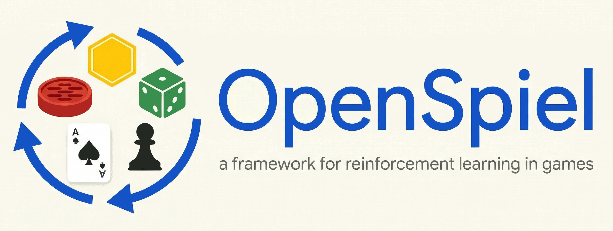

<!-- disableFinding(IMAGE_ALT_TEXT_INACCESSIBLE) -->
<!-- disableFinding(HEADING_REPEAT_H1) -->
<!-- disableFinding(SNIPPET_INVALID_LANGUAGE) -->
<!-- disableFinding("github") -->
<!-- disableFinding(LINK_CL_HEAD) -->

# OpenSpiel：博弈强化学习与决策规划框架 (A Framework for Reinforcement Learning in Games)

[](https://openspiel.readthedocs.io/en/latest/?badge=latest)

[](https://www.python.org)

<p align="center">
  <a href="README.md">English</a> · <b>简体中文</b>
</p>

OpenSpiel 是用于博弈场景中通用强化学习（General Reinforcement Learning）与搜索/规划（Search/Planning）研究的环境与算法集合。OpenSpiel 支持包含 n 个玩家（单智能体与多智能体）的零和博弈（Zero-sum）、合作与一般和博弈（Cooperative and General-sum）、单步与序列决策（One-shot and Sequential）、严格轮流出招与同时行动（Strictly turn-taking and Simultaneous-move）、完美信息与不完全信息博弈（Perfect and Imperfect information games），以及传统的多智能体环境，例如（部分可观测与完全可观测的）网格世界（Grid worlds）与社会困境（Social dilemmas）。OpenSpiel 还包含了用于分析学习动态过程（Learning dynamics）及其他常见评测指标的分析工具。各类博弈均被形式化表示为过程扩展形式博弈（Procedural extensive-form games），并带有一些自然扩展。其核心 API 与博弈逻辑使用 C++ 实现并封装暴露给 Python；算法与工具则同时提供 C++ 和 Python 两种实现。

如需在 Google Colaboratory 中直接体验 OpenSpiel，请参考 `open_spiel/colabs` 子目录，或直接从[此处开始体验](https://colab.research.google.com/github/deepmind/open_spiel/blob/master/open_spiel/colabs/install_open_spiel.ipynb)。

<p align="center">
  
</p>

# 目录索引 (Index)

请按需查阅以下核心文档：

*   [安装 OpenSpiel](docs/install.md)（适用于 Linux 和 macOS；Windows 用户请参阅独立的 [Windows 安装指引](docs/windows.md)）
*   [OpenSpiel 入门简介](docs/intro.md)
*   [API 核心概览与首个示例](docs/concepts.md)
*   [API 参考手册](docs/api_reference.md)
*   [已实现博弈环境概览](docs/games.md)
*   [已实现算法概览](docs/algorithms.md)
*   [开发者指南](docs/developer_guide.md)
*   [将 OpenSpiel 作为 C++ 库使用](docs/library.md)
*   [开发准则与参与贡献](docs/contributing.md)
*   [项目作者与贡献者](docs/authors.md)

关于核心概念、形式化定义与术语规范的更深入介绍，以及已支持算法与部分实验成果的系统性综述，请参阅学术论文：[OpenSpiel: A Framework for Reinforcement Learning in Games](https://arxiv.org/abs/1908.09453)。

如需获取 OpenSpiel 综述介绍及核心 API 的实战用例，请观看我们的官方教学视频：

*   [研究动机、核心 API、复制动态学（Replicator Dynamics）与不完全信息博弈简介](https://www.youtube.com/watch?v=8NCPqtPwlFQ)，讲师：Marc Lanctot。[（课件 Slides）](http://mlanctot.info/files/OpenSpiel_Tutorial_KU_Leuven_2022.pdf) [（Colab 实战）](https://colab.research.google.com/github/deepmind/open_spiel/blob/master/open_spiel/colabs/OpenSpielTutorial.ipynb)
*   [研究动机、核心 API、基于 Kuhn 扑克、Leduc 扑克与 Goofspiel 的反事实遗憾最小化（CFR）与 REINFORCE 算法实现](https://www.youtube.com/watch?v=o6JNHoGUXCo)，讲师：Edward Lockhart。[（课件 Slides）](http://mlanctot.info/files/open_spiel_tutorial-mar2021-comarl.pdf) [（Colab 实战）](https://colab.research.google.com/github/deepmind/open_spiel/blob/master/open_spiel/colabs/CFR_and_REINFORCE.ipynb)

若在您的学术研究中使用了 OpenSpiel，请使用以下 BibTeX 引用我们的论文：

```bibtex
@article{LanctotEtAl2019OpenSpiel,
  title     = {{OpenSpiel}: A Framework for Reinforcement Learning in Games},
  author    = {Marc Lanctot and Edward Lockhart and Jean-Baptiste Lespiau and
               Vinicius Zambaldi and Satyaki Upadhyay and Julien P\'{e}rolat and
               Sriram Srinivasan and Finbarr Timbers and Karl Tuyls and
               Shayegan Omidshafiei and Daniel Hennes and Dustin Morrill and
               Paul Muller and Timo Ewalds and Ryan Faulkner and J\'{a}nos Kram\'{a}r
               and Bart De Vylder and Brennan Saeta and James Bradbury and David Ding
               and Sebastian Borgeaud and Matthew Lai and Julian Schrittwieser and
               Thomas Anthony and Edward Hughes and Ivo Danihelka and Jonah Ryan-Davis},
  year      = {2019},
  eprint    = {1908.09453},
  archivePrefix = {arXiv},
  primaryClass = {cs.LG},
  journal   = {CoRR},
  volume    = {abs/1908.09453},
  url       = {http://arxiv.org/abs/1908.09453},
}
```

## 版本控制 (Versioning)

本项目遵循[语义化版本规范 (Semantic Versioning)](https://semver.org/)。

---

> **翻译说明（Translation Disclaimer）**
> 本文档由社区志愿者（[@JasonYeYuhe](https://github.com/JasonYeYuhe)）人工翻译并维护，旨在降低中文开发者的阅读门槛。最后同步日期：2026年10月18日。若译文与英文原版存在任何出入或滞后，请以 [英文原版 (README.md)](README.md) 为准。欢迎通过 PR 协助改进译文！
